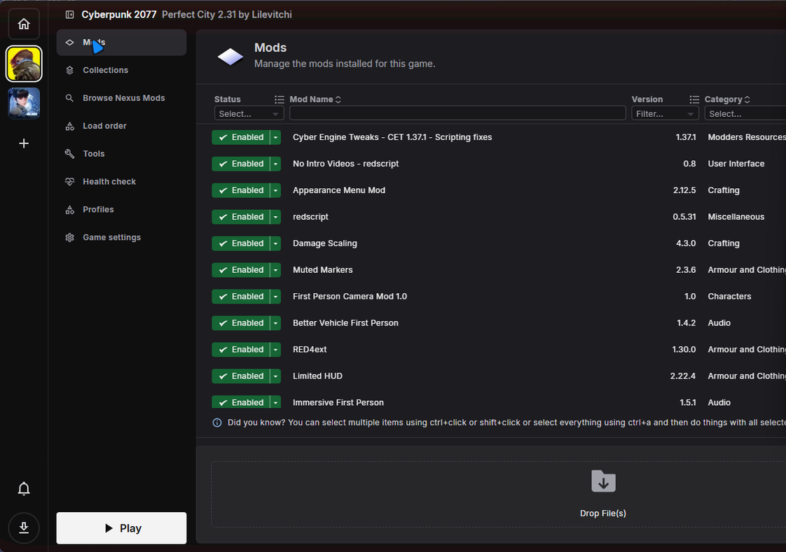
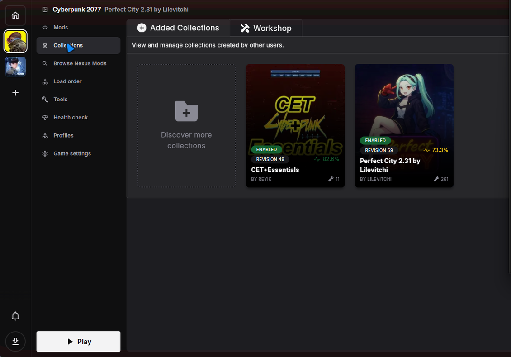

# Vortex Free Collections Patch

A small, reversible patch for [Vortex Mod Manager](https://github.com/Nexus-Mods/Vortex) **2.9.0** that makes Nexus Mods **collections** download and install **automatically on a free Nexus account** — the hands-off behaviour Nexus otherwise sells as Premium's "Auto-download all". No per-mod pop-ups, no opening a web browser, no userscript manager.

The one thing you still do, once: sign in to nexusmods.com in a small window the first time a collection needs it. After that the sign-in is remembered and collections run start to finish on their own. (Premium also requires you to be logged in, so this is not an extra step.)

Download **speed** stays at Nexus's normal free limit (~3 MB/s). Only the automatic, no-click *behaviour* is changed.

> **Unofficial community patch.** Not made by, or affiliated with, Nexus Mods or the Vortex team.

---

## See it working

A full Nexus collection installed on a **free** account — every mod auto-downloaded and **Enabled**, no per-mod pop-ups and no browser:



The collections themselves, both showing **Enabled** after a hands-off install:



---

## Install (easiest)

1. Grab `VortexFreeCollections-Setup.exe` from the [Releases](../../releases) page.
2. Close Vortex.
3. Run the installer. It finds your Vortex folder automatically (confirm or pick it), then patches it.
4. Start Vortex and install a collection as normal.

Windows may show a blue **"Windows protected your PC"** box because the installer is not code-signed. Click **More info → Run anyway**.

**To undo:** uninstall *"Vortex Free Collections Patch"* from Windows Settings → Apps. That restores Vortex's original files exactly. Updating or reinstalling Vortex also replaces the patched files.

Requires **Vortex 2.9.0**. The installer checks the version and warns if it differs.

---

## How it works

Vortex is an Electron app. On a free account the normal "download" button hands collection mods off to a browser; Premium skips that. The website's own *slow-download* button, though, mints a ready-to-use signed CDN link via:

```
POST https://www.nexusmods.com/Core/Libs/Common/Managers/Downloads?GenerateDownloadUrl
body: fid=<fileId>&game_id=<numericGameId>&nmm=1
```

with your website login cookies. This patch runs that same request from a hidden, logged-in web session inside Vortex and feeds the resulting link straight into Vortex's existing download pipeline — so a free account gets the same automatic flow Premium does. Requests are paced to stay within Nexus's limits, and the link is checked to belong to the signed-in account before use.

The code lives in `src/renderer/src/extensions/nexus_integration/freeDownload/` and hooks `nxmProtocol.ts`. See [`patches/free-collections.patch`](patches/free-collections.patch) for the exact diff against Vortex 2.9.0.

The installer never touches the signed `Vortex.exe`. It swaps one file — the renderer bundle — inside Vortex's app files (Vortex 2.9.0 ships with the Electron asar-integrity and `onlyLoadAppFromAsar` fuses off, so an unpacked `resources\app\` folder loads cleanly) and keeps the original as a backup for a clean revert.

---

## Build from source

See [`installer/BUILD.md`](installer/BUILD.md). In short: clone Vortex at the 2.9.0 tag, apply `patches/free-collections.patch`, build the renderer bundle, then build the installer with Inno Setup.

---

## License & attribution

Vortex is licensed **GPL-3.0**, and so is this patch — see [`LICENSE`](LICENSE). The patched source (the files under `src/` and the diff in `patches/`) is the corresponding source for the modification, on top of upstream Vortex 2.9.0 (`Nexus-Mods/Vortex`, tag `v2.9.0`). Vortex and the Nexus Mods name are trademarks of their respective owners; this project is not endorsed by them.

**Use at your own risk.** Automating free downloads may be against the Nexus Mods terms of service, and sharing or using this tool could put your account at risk or draw a takedown. You are responsible for how you use it.
